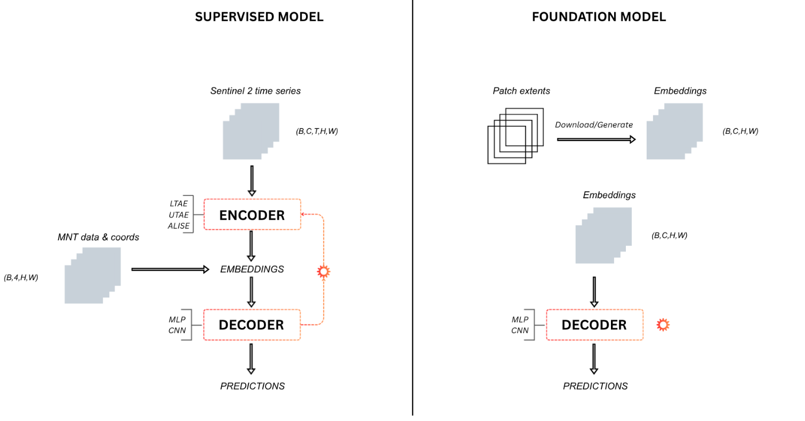

## Next-OSO classification by Deep Learning approaches

**Delivery Date :**  November 20th, 2026

## Description
This repository contains codes to train and evaluate Deep Learning (DL) models as well as Foundation model's embeddings on the Next-OSO dataset. Next-OSO project aims to enhance the current Land Cover classification OSO produces every year by the CESBIO laboratory. Two approaches are investigated:

1.) End-to-end supervised model: an encoder-decoder architecture is trained in a fully supervised manner on the Next-OSO dataset.

2.) Foundation Model embeddings: embeddings extracted from or generated by Foundation Models are used as input to a decoder, which is trained in a supervised manner on the Next-OSO dataset.



## Tree
```
.
├── analyse_results        # Python scripts and notebook to analyse results
├── configs                # YAML config files for models' parameter and train configuration
├── data_functions         # Functions and objects reltive to Next-OSO Dataset
├── download_embeddings    # Functions to download (Alpha-Earth, Tessera) or generate (MALICE) embeddings
├── embedding              # Functions and objects reltive to embedding data
├── mains                  # Python Lightning scripts to train, test and infers for DL models (on next-OSO) and for embeddings (on Next-OSO and PASTIS)
├── old                    # Old training process PyTorch
├── pastis                 # Functions, scripts and objects reltive to PASTIS dataset
├── pixi.lock              # Pixi environment
├── pixi.toml              # Pixi environment
├── pyproject.toml         # Pixi environment
├── RandomForest           # Functions, scripts and objects reltive to recreate OSO pipeline
├── README.md
├── scripts                # SLURM scripts
├── src                    # Functions for metrics evaluation and loss functions
├── supervised_models      # Encoders architectures
├── templates              # Base class and constants
├── test                   # Pytests
├── overview.ipynb         # Notebook for getting started

```
## Environment
This project uses Pixi as package and environment manager.

**Installation**

Clone the repository and install the project environment:

git clone https://src.koda.cnrs.fr/kerinohugo/next_oso.git

cd next_oso

pixi install


**Environments**

Several environments are available depending on the intended use of the project.

All environments share the common project dependencies, while adding dependencies specific to their respective workflows.

| Environment | Purpose |
|-------------|---------|
| `cpu` | Run the project with CPU PyTorch |
| `gpu` | Run the project with GPU PyTorch |
| `dev` | Development, testing and linting |
| `download` | Download AlphaEarth and GeoTessera embeddings |
| `default` | Default environment, equivalent to `cpu` |

Command line to use a specific environment :

```bash
pixi run -e <env> <command>
```

The dependencies are specified in pixi.toml, while pixi.lock records the exact dependency versions used to ensure reproducibility.


## Usage

**Examples**

* Training ALISE architecure on a GPU on first fold :

```bash
pixi run -e gpu python mains/main_supervised_training.py \
    --config_train configs/models/config_trex.yaml \
    --config_model configs/models/ALISE.yaml \
    --fold_index 0
```

* Kfold training of a supervised model on SLURM environement :

```bash
sbatch scripts/script_supervised_train_kfold.slurm
```

During training, a log directory is created with the following structure :

```
.
├── config_parameters.json     # Store all parameters used for training
├── fold_1
│   ├── Checkpoints            # Contains best model in .ckpt format
│   ├── metrics.xlsx           # Evaluation metrics
│   ├── raw_matrix.pt          # Confusion matrix. no-normalize
│   └── tensorboards           # store tensorboards tracking training and model evaluation metrics
├── fold_2
...
└── fold_5
    ├── Checkpoints
    ├── metrics.xlsx
    ├── raw_matrix.pt
    └── tensorboards
```

To compute mean metric accross 5 folds :

```bash
pixi run python src/summarize_kfold.py \
    --root_dir path_to_log_directory \
    --output_file name_of_the_xlsx_file \
```

* Test an embedding model already train on last folds :
```bash
pixi run python mains/main_embedding_testing.py \
    --config configs/FM_models/config_trex.yaml \
    --path_dir_logs path_to_directory_containing_models_log_and_checkpoints \
    --fold_index 4
```

## Tests

Basic tests have been implemented with Pytest to ensure the correctness of the main components and to detect regressions during development. These tests provide a minimal validation of the project's core functionalities.


* To run all tests (can be long especially due to one test in test_RF.py):

```bash
pixi run -e dev pytest
```
or equivalent
```bash
make test
```

To run all tests without ones taking too long (recommended):

```bash
pixi run -e dev pytest -m "not slow"
```

To run only one selected test:

```bash
pixi run -e dev pytest tests/test_<test_name>.py
```
